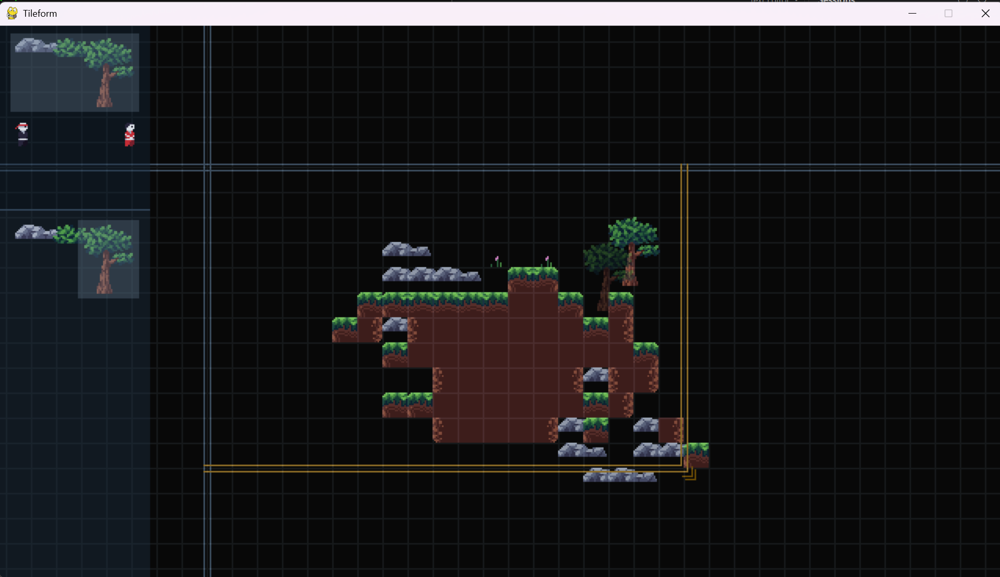
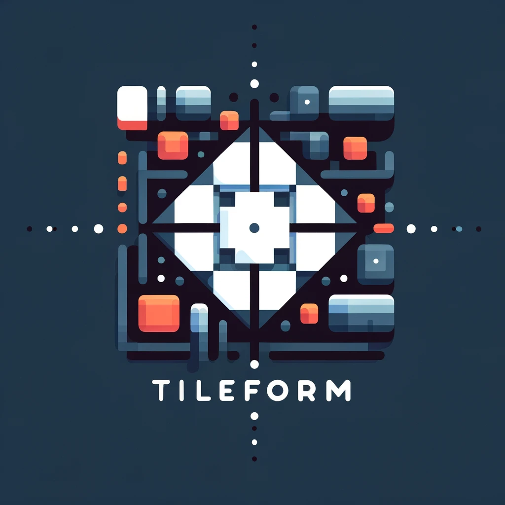

# Tileform - Adaptation of Level Editor of https://www.youtube.com/watch?v=2gABYM5M0ww



Adaptation of https://youtu.be/2gABYM5M0ww?t=8545 (timestamped)

## Development

```
pip install requirements.txt
py main.py
```

---

## Trivia



Introducing **Tileform**, your all-in-one solution for crafting immersive and visually captivating platformer games! 
As a game developer, creating a rich and dynamic world is crucial to engaging players, 
and our platformer tile editor is here to make that process seamless. 
With **Tileform**, you can design intricate levels, construct detailed landscapes, 
and bring your platformer dreams to life with pixel-perfect precision. 
Whether you're a seasoned developer or just starting your game creation journey, 
our intuitive interface and extensive library of tiles, characters, and props empower you to build, edit, and refine your platformer levels effortlessly. 
Elevate your game design to the next level with **Tileform**, 
where every tile you lay is a step closer to immersing players in an unforgettable gaming experience.
